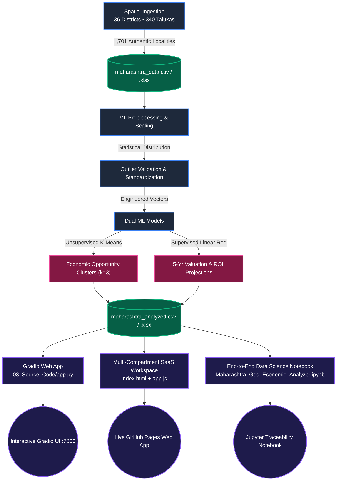

# 🌆 Maharashtra Geo-Economic & Real Estate Analyzer

[](https://git.io/typing-svg)

<div align="center">

[](https://iamneonirmal2007.github.io/Maharashtra-Geo-Economic-Real-Estate-Analyzer/)
[](https://www.python.org/)
[](https://scikit-learn.org/)
[](https://pandas.pydata.org/)
[](https://gradio.app/)
[](LICENSE)

<br>

**🌐 [Launch Live Interactive Web App](https://iamneonirmal2007.github.io/Maharashtra-Geo-Economic-Real-Estate-Analyzer/)** • **🚀 [Gradio Python Application](#option-1-standalone-gradio-web-application)** • **📊 [Jupyter Notebooks](#option-3-jupyter-notebook-execution)**

</div>

<br>

> **An institutional-grade spatial AI & real estate econometrics platform covering all 36 districts, 340 talukas, and 1,701 localities in Maharashtra.** Features village-specific economic profiles, Unsupervised K-Means Clustering ($k=3$), Supervised Linear Regression 5-Year Price Modeling ($R^2 \approx 0.999+$), a live mathematical step-by-step calculation engine, and a modern **Multi-Compartment SaaS Workspace** deployed seamlessly to GitHub Pages.

---

## 🚀 Live Demo & Deployment

The application is deployed live on **GitHub Pages**:
🔗 **[https://iamneonirmal2007.github.io/Maharashtra-Geo-Economic-Real-Estate-Analyzer/](https://iamneonirmal2007.github.io/Maharashtra-Geo-Economic-Real-Estate-Analyzer/)**

Every push to the `main` branch automatically triggers the `.github/workflows/deploy.yml` GitHub Actions CI/CD pipeline, building and deploying the web application with zero manual intervention.

---

## 🔄 System Architecture & Data Flow



---

## 💎 The Multi-Compartment SaaS Workspace Layout

The web application refactors the traditional single-page scroll into a high-density, modular **2-Column Split Workspace (Desktop) / Stacked (Mobile)** designed for strategic real estate analysis:

```
┌────────────────────────────────────────────────────────────────────────────────────────┐
│ COMPARTMENT 1: Sticky Header & Command Bar (⌘K Search, City Chips, Statewide Stats)   │
├──────────────────────────────────────┬─────────────────────────────────────────────────┤
│ COMPARTMENT 2: Pinned Dossier        │ COMPARTMENT 3: Dynamic Tabbed Analytical        │
│ Sidebar (Left 4 Columns — Sticky)    │ Workspace (Right 8 Columns)                     │
│                                      │                                                 │
│ • Geospatial Title & Subtitle        │ [ 📊 Forecast ] [ 🧮 Engine ] [ 🧬 Clusters ]   │
│ • Opportunity Status Badge           │ [ 📋 Directory ] [ ⚖️ Compare A vs B ]          │
│ • Circular AI Composite Score (0-100)│                                                 │
│ • Sub-Scores (Prop, Emp, Biz)        │ • Active Tab Panel Displays Exclusively        │
│ • 2x2 Key Benchmark Grid (₹/sq.ft)   │ • Auto Chart.js Resize on Tab Activation        │
│ • Quick Actions:                     │ • Step-by-Step Mathematical Derivations         │
│   - "⚖️ Compare Location" (Tab 5)    │ • Head-to-Head Comparative Intelligence Card    │
│   - "✦ Ask GeoAI" (Drawer Assistant) │ • 1,701 Locality Searchable Directory Table     │
└──────────────────────────────────────┴─────────────────────────────────────────────────┘
```

### 1. Compartment 1: Sticky Search & Command Header
- **Pre-Search State**: Displays the full hero banner (*"UNDERSTAND MAHARASHTRA BEFORE YOU INVEST"*) and the 4-card *Live Statewide Intelligence* stats banner (36 Districts, 340 Talukas, 1,701 Locations, ML Engine).
- **Post-Search State**: Smoothly collapses hero copy into a compact **Sticky Command Bar** with:
  1. Instant Search Input (`⌘K` shortcut) with live debounced autocomplete dropdown.
  2. Horizontal scrollable chips for rapid selection (**Mumbai, Pune, Nashik, Nagpur, Hinjawadi, Wagholi, Panvel, Chhatrapati Sambhajinagar, Kolhapur, Jalgaon**).
  3. **"🌐 Statewide Stats"** button to toggle the 4-card statewide summary banner on demand.

### 2. Compartment 2: Pinned Location Dossier Sidebar (Left 4 Columns)
- **Persistent Spatial Context**: Sticks smoothly on the left (`lg:sticky lg:top-24`) while analyzing deep tabs on the right.
- **AI Location Profile**: Interactive circular Composite Intelligence Index (0–100) with visual progress bars for Property Score, Employment Stability, and Commercial Opportunity.
- **2x2 Key Benchmark Grid**: Live benchmarks for Market Price (₹/sq.ft), 5-Year Target Model (₹/sq.ft), Workforce Participation Rate (%), and Economic Cluster Profile.
- **Quick Action Bar**:
  - **"⚖️ Compare Location"**: Automatically switches to Tab 5, pre-populates the current location as Location A, and benchmarks against prime nodes.
  - **"✦ Ask GeoAI"**: Opens the sliding intelligence assistant drawer with contextual Q&A grounded in the 1,701-location dataset.

### 3. Compartment 3: Dynamic Tabbed Analytical Workspace (Right 8 Columns)
Features a sticky pill-style navigation bar with 5 specialized analytical panels:
- **Tab 1: 📊 Forecast & Valuation (Default)**: 5-Year Linear Regression projection chart (Chart.js line chart with confidence bounds), 1/2/3 BHK benchmark cards with price/sq.ft toggle, and 4 socio-economic momentum signals.
- **Tab 2: 🧮 Calculation Engine**: 6-card step-by-step mathematical breakdown showing every formula, data retrieval query, and ML derivation evaluated live before generating output.
- **Tab 3: 🧬 Cluster & Ventures**: K-Means clustering characteristics, neighborhood profile, similar locality chips, and the Commercial Viability Engine suggesting high-yield business ventures.
- **Tab 4: 📋 Regional Directory**: High-performance searchable locality table with instant taluka filtering and opportunity badges.
- **Tab 5: ⚖️ Compare (A vs B)**: Head-to-Head Comparative Intelligence module allowing dual-location side-by-side metric delta comparison with visual dual-bar gauges.

---

## 🧮 Live Step-by-Step Calculation Engine

The platform emphasizes **full algorithmic transparency**, evaluating all mathematical derivations live before presenting recommendations:

```
[01 • SPATIAL QUERY] ──→ [02 • STATISTICAL MEAN] ──→ [03 • MACROECONOMICS]
        │                         │                           │
        ▼                         ▼                           ▼
 Sub-string Search         ∑ Prices ÷ N Properties      ∑ Emp% ÷ Localities
 1,701 Localities Space    Weighted Base Rate (₹/sqft)  Demographic Vector

[04 • SUPERVISED ML] ──→ [05 • FINANCIAL RETURNS] ──→ [06 • UNSUPERVISED ML]
        │                         │                           │
        ▼                         ▼                           ▼
 Price(2031) = P × 1.42    Net Profit = P2031 - P2026    AI Index = 35% P +
 Linear Regression         ROI% = Profit/Base × 100%    35% E + 30% B (k=3)
```

| Step | Engine Module | Mathematical Formulation | Live Output Evaluated |
|:---:|---|---|---|
| **01** | **Spatial Query** | $\mathcal{Q} = \{ r \in \mathcal{D} \mid q \subseteq (\text{Village} \cup \text{Taluka} \cup \text{District}) \}$ | Matched Micro-Markets, Sample Pills, Primary District |
| **02** | **Statistical Mean** | $\bar{P}_{\text{BHK}} = \frac{1}{N} \sum_{i=1}^N P_i \quad \text{Rate} = \frac{\bar{P} \times 10^5}{\text{Carpet Sq.Ft}}$ | 1, 2, 3 BHK Mean Prices & Weighted Rate/Sq.Ft |
| **03** | **Macroeconomics** | $\bar{E} = \frac{1}{N} \sum_{i=1}^N E_i \quad U = 100\% - \bar{E}$ | Workforce Rate, Unemployment Index, Locality Tier |
| **04** | **Supervised ML** | $\hat{y}_{2031} = y_{2026} \times 1.42 \quad (R^2 > 0.99)$ | 5-Year Projected Price & Future Rate/Sq.Ft |
| **05** | **Financial Returns** | $\Pi = \hat{y} - y \quad \text{ROI} = \left(\frac{\Pi}{y}\right) \times 100\%$ | Absolute Capital Gain (+₹Lakhs), 5-Yr ROI, Velocity (% p.a.) |
| **06** | **Unsupervised ML** | $\mathcal{I} = 0.35 S_{\text{prop}} + 0.35 S_{\text{emp}} + 0.30 S_{\text{biz}}$ | Economic Cluster Archetype, Sub-Scores, Composite Index |

---

## 📌 Dataset Coverage & Authenticity

| Dimension | Specification & Authenticity |
|---|---|
| **Districts Covered** | **36 / 36 (100% Complete Statewide Coverage)** |
| **Talukas Covered** | **340 Talukas** |
| **Total Micro-Markets** | **1,701 Localities** |
| **Locality Archetypes** | Metro Wards, Tier-2 Urban Centers, Industrial MIDC Zones, Coastal Ports, Agro-Rural Hubs |
| **Real Estate Metrics** | Land Price (₹/sq.ft), 1 BHK (₹ Lakhs), 2 BHK (₹ Lakhs), 3 BHK (₹ Lakhs) |
| **Economic Attributes** | Employment Participation Rate (%), Commercial Activity Index (1–10), Infrastructure Score (1–10) |
| **Qualitative Grounding** | Individual **Village-Specific Socio-Economic Background** and **5-Year Growth Catalysts** annotated for every record |

---

## 📁 Repository Structure

```
├── .github/
│   └── workflows/
│       └── deploy.yml                       # Automated GitHub Pages CI/CD Workflow
├── 01_Data/                                 # Raw & Preprocessed Data Assets
├── 02_Notebooks/                            # Experimental Science Notebooks
├── 03_Source_Code/
│   ├── app.py                               # Standalone Gradio Python Backend
│   └── StepByStepCalculationEngine.jsx       # Modern React + Tailwind Component
├── 04_Web_App/                              # Web Application Distribution
├── 05_Output/                               # Exported Visualizations & Charts
├── 06_Deployment_Config/                    # Deployment Configurations
├── 07_Dependencies_Docs/                    # Dependency Lists & Manuals
├── app.js                                   # Workspace Controller, Charts, ML Math & Tabs
├── app.py                                   # Root Standalone Gradio Application
├── index.html                               # Modern Multi-Compartment SaaS Workspace HTML
├── style.css                                # Design System (Light Mode SaaS Workspace, Bento Cards)
├── maharashtra_data.csv                     # Raw Geo-Economic Dataset (1,701 records)
├── maharashtra_data.xlsx                    # Raw Dataset (Excel Format)
├── maharashtra_analyzed.csv                 # Model-Scored Dataset with Clusters & Predicted ROI
├── maharashtra_analyzed.xlsx                # Model-Scored Dataset (Excel Format)
├── .gitignore                               # Git Ignore Configuration
├── .nojekyll                                # Disables Jekyll Processing on GitHub Pages
├── LICENSE                                  # MIT License
└── README.md                                # Project Documentation
```

---

## 🛠️ Local Installation & Execution

### Option 1: Standalone Web Workspace (Instant Offline or Hosted)
Simply launch `index.html` in your favorite web browser:
```bash
# Windows
start index.html

# macOS
open index.html

# Linux
xdg-open index.html
```
Or view the live cloud deployment on [GitHub Pages](https://iamneonirmal2007.github.io/Maharashtra-Geo-Economic-Real-Estate-Analyzer/).

---

### Option 2: Standalone Gradio Python Application

```bash
# 1. Clone repository
git clone https://github.com/IAMNEONIRMAL2007/Maharashtra-Geo-Economic-Real-Estate-Analyzer.git
cd Maharashtra-Geo-Economic-Real-Estate-Analyzer

# 2. Create virtual environment
python -m venv venv
.\venv\Scripts\activate      # Windows
# source venv/bin/activate    # Linux / macOS

# 3. Install requirements
pip install -r 07_Dependencies_Docs/requirements.txt  # or: pip install gradio pandas scikit-learn

# 4. Launch Gradio server
python app.py
```
Access the application at: **`http://127.0.0.1:7860`**

---

### Option 3: Jupyter Data Science Notebook
```bash
jupyter lab
```
Open `Maharashtra_Geo_Economic_Analyzer.ipynb` and select **Kernel → Restart & Run All**.

---

## 📜 License
This project is open-source and distributed under the [MIT License](LICENSE).

## 👨‍💻 Author & Maintainer
**Nirmal Borole** ([@IAMNEONIRMAL2007](https://github.com/IAMNEONIRMAL2007))  
*Developer & AI Systems Builder*
